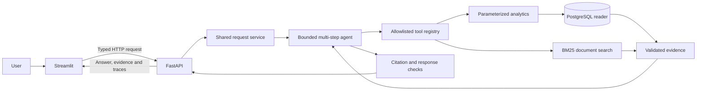

# QueryPilot AI

**An evidence-backed, tool-using AI agent for business analytics.**

QueryPilot AI connects a modular Python/FastAPI backend to approved PostgreSQL analytics
and business-document retrieval. Each question runs through a bounded agent loop and
returns inspectable tool traces, typed evidence and source citations in Streamlit.
All business data is synthetic and publicly shareable.

[Repository](https://github.com/Srikarpanuganti5/querypilot_ai) ·
[GitHub Actions](https://github.com/Srikarpanuganti5/querypilot_ai/actions/workflows/ci.yml) ·
[Documentation](docs/README.md) · [Developer handoff](docs/final-handoff.md)

**Status:** private local Docker demo; deterministic mock-provider workflows verified with
real SQL and BM25 retrieval. The OpenAI adapter is implemented and protocol-tested;
**live OpenAI and manual browser acceptance remain unverified**. No public demo is hosted.

## Highlights

- FastAPI REST API with strict Pydantic contracts, safe errors and correlated request logs.
- Five predefined SQL analytics tools over a six-table PostgreSQL e-commerce schema.
- Restricted reader credentials, parameterized queries and explicit read-only transactions.
- Multi-step function calling with isolated request state, deadlines and execution budgets.
- BM25 search over ten synthetic policy documents, with exact source citations.
- Streamlit chat with SQL tables, tool details and explicit partial-result notices.
- Alembic migrations, reproducible fixtures, non-root containers and isolated persistent data.
- Automated API, provider-protocol, security, database, HTTP and UI tests; case-level evaluation gates.

## Architecture



The provider proposes calls; application code validates and executes them. Display history
stays in the frontend session and is never agent memory. See the
[request lifecycle and deployment diagrams](docs/architecture.md).

## Run the private demo

Prerequisites: Git, Python **3.12**, [uv](https://docs.astral.sh/uv/getting-started/installation/),
Docker with Compose v2 support, and Make for the shortcut commands. Run from the repository
root. The exact locked dependencies are used locally and in CI; no OpenAI key is needed.

```sh
git clone https://github.com/Srikarpanuganti5/querypilot_ai.git
cd querypilot_ai
uv sync --python 3.12 --extra dev --locked
.venv/bin/python scripts/prepare_docker.py
make demo-up
make demo-smoke
```

The helper generates private setup/reader credentials in ignored `.env.docker`, preserves
existing settings and leaves native PostgreSQL untouched. Compose starts an isolated
PostgreSQL 16 volume, applies migration `0001`, seeds the pinned synthetic fixture and
verifies reader privileges through a one-shot setup job. Existing mismatched data is refused,
not overwritten. The project retains its historical namespace `querypilot_day12`.

| Service | Local URL | Purpose |
| --- | --- | --- |
| Streamlit | http://127.0.0.1:18501 | Private chat demo |
| FastAPI docs | http://127.0.0.1:18000/docs | API exploration |
| Liveness | http://127.0.0.1:18000/health | Process status |
| Readiness | http://127.0.0.1:18000/ready | Reader/schema/data/document prerequisites |

PostgreSQL has **no host-published port**. `QP_BACKEND_PORT` and `QP_FRONTEND_PORT` in
`.env.docker` change host bindings if occupied. Internal frontend HTTP uses `backend:8000`.
Do not print resolved Compose settings or share environment files.

Try these questions with **Mock demo** selected:

1. “What is our return policy?”
2. “What are our top five products by revenue?”
3. “Which products generated the most revenue, and what is our refund policy?”
4. “How many failed payments occurred, and how are failed payments handled?”

Mock mode uses a deterministic selector and answer template; SQL/document execution is real.
Top-five evidence carries a limited-selection notice. Citations validate provenance, not
semantic correctness of every claim. **Demo recording: pending capture. Screenshots: pending
manual browser review.** No fabricated media or public-demo URL is supplied.
[Demo script and browser checklist](docs/demo.md).

Verify or stop the stack:

```sh
curl --fail http://127.0.0.1:18000/ready
.venv/bin/python -m querypilot.cli smoke-test --backend-url http://127.0.0.1:18000
.venv/bin/python scripts/verify_demo_ui.py --backend-url http://127.0.0.1:18000
# After the demo; retains the named database volume:
make demo-down
```

`make demo-smoke` runs inside the backend and independently verifies the configured reader's
exact fixture and SQL results. The host command omits direct database verification explicitly.
AppTest is automated UI verification and does not replace graphical browser acceptance.
For systems without Make, the matching Compose commands are in [containers.md](docs/containers.md).

## Technology stack

| Area | Technologies and purpose |
| --- | --- |
| Backend | Python 3.12, FastAPI, Uvicorn; Pydantic/Settings for contracts/configuration |
| Database | PostgreSQL 16, SQLAlchemy, Psycopg, Alembic migrations |
| Agent integration | OpenAI Python SDK Responses adapter; bounded tool-calling loop; deterministic mock provider |
| Retrieval | In-process BM25 over approved local Markdown; no embeddings or external search service |
| Frontend | Streamlit and a typed, bounded HTTPX client |
| Testing | Pytest, coverage, Ruff; real PostgreSQL and Streamlit AppTest |
| DevOps | Docker Compose, locked uv dependencies, GitHub Actions |

Runtime dependencies serve these boundaries; Pytest, Ruff and coverage are development
only. Hatchling builds the src-layout package. No new dependency is needed for the final review.

## Engineering decisions

- **FastAPI:** typed HTTP contracts and dependency injection keep transport separate from
  business services, with generated API documentation and isolated test configuration.
- **PostgreSQL:** explicit relational constraints, NUMERIC accounting, real transaction/role
  behavior and reproducible SQL integration tests suit the synthetic business model.
- **Allowlisted queries and reader role:** the model chooses business operations, never
  arbitrary SQL. Bound arguments and database privileges independently limit capability.
- **Evidence and citations:** users can inspect actual rows/passages and limitations.
  Mechanical source/number checks make failures observable without claiming semantic proof.
- **Evaluation:** a versioned benchmark exposes routing/filter/abstention weaknesses and
  protects individual passing cases rather than hiding regressions behind an average.
- **Docker and CI:** a one-shot setup, service health dependencies and mandatory real-DB
  tests make execution reproducible across machines and detect deployment integration defects.

## Tests and evaluation

Latest local review: **2026-11-12**. Exact commands, durations and results are in
[final verification](docs/final-verification.md); older milestone measurements remain historical.

| Measurement | Result | Interpretation |
| --- | --- | --- |
| Automated tests | 470 passed; 0 failed; 0 skipped | Software regression suite |
| Real PostgreSQL cases | 56 | Includes every original required integration case |
| Coverage | 89.90% statements; 84.22% branches | `src/querypilot`; scripts/tests excluded |
| Agent benchmark | 24/38 (63.16%), across 14 categories | Deterministic mock provider with real tools |
| Protected regression gate | 24/24 retained; 0 regressions | All 14 known failures remain visible |
| Remote CI | Both jobs passed at `6135c17` | Day 13 committed baseline; Day 14 work is local |

A green software suite is separate from agent benchmark success. Mock scores do not measure
live LLM accuracy. Semantic faithfulness, claim-level entailment, load capacity and production
users are not measured. [Definitions](docs/evaluation.md) · [All 14 failures and backlog](docs/benchmark-backlog.md).

Native CI parity requires the owned test environment:

```sh
.venv/bin/python scripts/prepare_local.py
set -a
source .local/integration.env
set +a
.venv/bin/python scripts/run_checks.py
```

Native preparation requires PostgreSQL server binaries (`initdb`, `pg_ctl`, `psql`); it owns
an isolated loopback cluster and dedicated synthetic dev/test databases. It preserves existing
configuration. The parity runner rejects all skipped tests and enforces the original 50
PostgreSQL node IDs, runs coverage, doctor and the benchmark gate. Bare `pytest` without
configured test URLs explicitly skips database cases and is not full CI parity.

To run the same full quality checks entirely in the separate Docker test project:

```sh
make docker-test
docker compose --env-file .env.docker -p querypilot_day12_test -f compose.yaml -f compose.test.yaml down --timeout 40
```

Run the benchmark/gate against the demo reader without host database configuration:

```sh
docker compose --env-file .env.docker -f compose.yaml -f compose.demo.yaml exec -T backend python -m querypilot.cli eval --mode mock --output /tmp/day14-eval
docker compose --env-file .env.docker -f compose.yaml -f compose.demo.yaml exec -T backend python -m querypilot.evaluation.gate --output /tmp/day14-gate
```

The full benchmark deliberately exits **1** for its 14 failed expectations and saves reports;
the case-level regression gate exits **0** when protected cases remain passing. Generated
reports are ignored/private. Never regenerate gold labels from current model outputs.

## Native backend and frontend

After `uv sync` and `scripts/prepare_local.py`, use separate terminals from the repository root:

```sh
# Backend (loads ignored .env; restart after changing configuration):
.venv/bin/uvicorn querypilot.main:app --host 127.0.0.1 --port 8000 --no-access-log
# Frontend:
QUERYPILOT_API_BASE_URL=http://127.0.0.1:8000 .venv/bin/streamlit run src/querypilot/frontend/app.py --server.address 127.0.0.1 --server.port 8501
# Read-only diagnostics:
.venv/bin/python -m querypilot.cli doctor --reference-date 2026-10-27 --backend-url http://127.0.0.1:8000
```

Stop foreground servers with Ctrl+C. Migrations/seeding are explicit setup operations;
application imports/startup do not provision databases or call models. Supported agent
endpoints are `POST /api/v1/agent/ask` and `GET /api/v1/agent/capabilities`; `/api/v1/chat`
is absent. See [.env.example](.env.example), [native setup](docs/testing.md),
[database/accounting](docs/database.md) and [OpenAI configuration](docs/llm.md).
The default Docker workflow is mock-only; paid live verification requires separate approval.

## Security and limitations

Tools use fixed parameterized SELECTs, a SELECT-only reader, strict input/output contracts,
role audits and read-only transactions. Setup credentials are isolated. Agent iterations,
calls, context, evidence, deadlines and results are bounded; retrieved passages remain
untrusted data. Public traces omit provider reasoning/arguments; errors/logs use safe fields
and credential screening. These controls are tested engineering boundaries, not a formal audit.

The demo binds application ports to loopback and publishes no PostgreSQL port. Public access
is blocked pending **authentication, authorization, rate limiting, HTTPS/WSS, protected
diagnostics, monitoring, backups and operational review**. CORS is not access control.
Manual browser acceptance and live OpenAI remain pending. The 14 benchmark failures cover
routing, missing filters, evidence gaps and abstention. Future work should address those
with independent tests, then evaluate live behavior under an approved budget. Worker threads
cannot be forcibly killed; cleanup may exceed an await deadline. No persistent agent memory
or public cloud deployment is implemented. [Security review](docs/security.md).

## Project and author

Built by [Srikarpanuganti5](https://github.com/Srikarpanuganti5).
[Source repository](https://github.com/Srikarpanuganti5/querypilot_ai).
The [14-day roadmap](PLANS.md) and [progress log](docs/progress.md) record implementation
and verification history. [Portfolio/interview notes](docs/portfolio.md) and
[launch drafts](docs/linkedin-launch.md) are preparation materials, not published assets.
