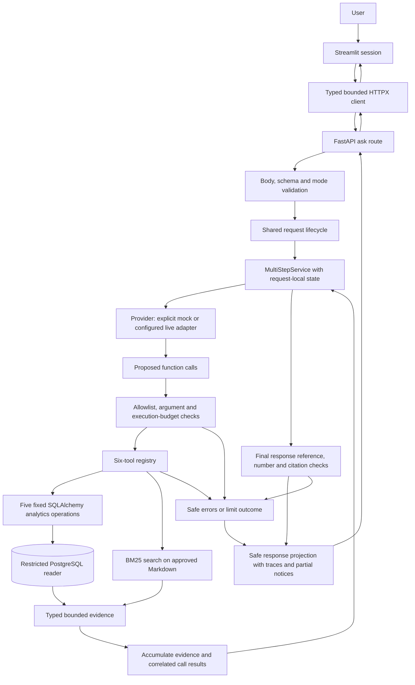
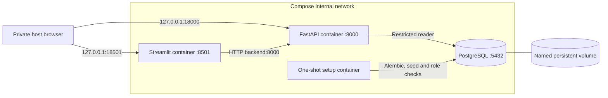

# Architecture

QueryPilot AI separates HTTP transport, request orchestration, approved tools and data
access in a Python 3.12 src-layout package. The current system includes FastAPI, Streamlit,
PostgreSQL analytics, BM25 document search, an OpenAI Responses adapter and an explicit
mock provider. Local acceptance uses the mock provider with real tools. No persistent
agent memory or public deployment is implemented. [Verification](final-verification.md).

## Request and evidence flow

The loop decides between further calls and a final answer under explicit limits. Error
edges preserve prior evidence where safe; failed prerequisites or invalid grounding do
not fabricate a substitute answer. The frontend renders passages as plain text and
SQL as read-only tables. Display history never becomes model context.

## Transport and lifecycle

`main.create_app()` composes FastAPI, validated settings, safe handlers, request-ID logging
and explicit-origin CORS. Package imports and API startup do not connect to databases,
apply migrations or call providers. The supported endpoints are:

| Endpoint | Boundary |
| --- | --- |
| `GET /health` | Process liveness, independent of external services |
| `GET /ready` | Read-only database/schema/seed/role/corpus/mock readiness; 503 on failure |
| `GET /api/v1/info` | Installed package metadata |
| `GET /api/v1/agent/capabilities` | Safe mode availability and execution limits |
| `POST /api/v1/agent/ask` | Independent question and explicit mock/live mode |
| `GET /docs`, `/redoc`, `/openapi.json` | Generated API documentation/schema |

`/api/v1/chat` is absent. The middleware bounds HTTP bodies at 65536 bytes; Pydantic bounds
questions at 4000 characters. Live HTTP requires server opt-in and configured key/model.
Capabilities/startup/mode changes make no model requests. Live errors never switch to mock.
The documentation HTML uses framework CDN assets; HTTP checks do not prove their browser rendering.

`services.agent.execute_question` owns one request's provider/registry and invokes
`MultiStepService`. CLI, API and evaluation reuse it. Final cleanup drains owned work
before closing resources. Public response schemas omit raw provider call IDs, arguments,
reasoning and internal conversation state; safe traces retain operation, status, timings,
iterations, evidence and limitations. Unknown sensitive input is not comprehensively anonymized.

The frontend's typed HTTPX client uses bounded bytes/timeouts, no redirects, inherited
proxy credentials or automatic retries. It validates schemas and returned mode. Streamlit
loads only frontend origin configuration, retains at most 20 displayed exchanges and
requires explicit submission. It never needs backend database or OpenAI credentials.

## Agent loop and tool boundary

Each run creates an isolated `AgentState`: UUID, monotonic start, iterations, messages,
call IDs, canonical fingerprints, evidence, citations, errors and status. Provider turns
and call-result messages retain original protocol correlation, including reasoning items.
The service validates role/ID/call budgets, suppresses canonical duplicate executions and
stops when context cannot fit rather than dropping required replay messages.

Defaults: 5 model iterations, 10 total calls, 5 calls per iteration, 90-second execution
budget, 128000 context bytes and 48000 evidence bytes. These are UTF-8 serialization bounds,
not token counts or an LLM context-window guarantee. See [agent.md](agent.md) for hard limits.
Unknown tools and invalid arguments execute no unauthorized operation. Ordinary safe tool
failures can be returned for provider recovery; malformed batches, deadlines and fatal
provider/evidence errors terminate safely. `pending_tool_calls` discloses accepted unfinished work.

Synchronous tools execute in owned workers. Cancellation propagates only after workers
are drained, avoiding resource-close races. Python threads cannot be forcibly terminated;
cleanup can exceed the await budget. Database/file bounds remain essential. See
[security.md](security.md). The retained Day 6 `SingleRoundService` is independently usable
and regression-tested; current ask CLIs use the multi-step service.

## SQL and documents

The fixed registry exposes `get_top_products`, `get_revenue_summary`, `get_refund_analytics`,
`get_customer_order_summary`, `get_payment_status_summary` and `search_business_documents`.
It accepts no SQL string, dynamic function, filesystem path or shell operation. SQLAlchemy
builders own query structure; validated dates, IDs and limits are bound parameters.

A distinct SELECT-only role is mandatory. Audit rejects elevated roles, memberships, table
ownership and write/schema/TEMP privileges, and requires SELECT on six business tables.
Transactions explicitly enforce read-only mode and statement timeouts. Writer credentials
are never a tool fallback. Decimal/NUMERIC money serializes as strings; queries retain
UTC and completed-revenue/payment/refund accounting rules. [Database](database.md) · [Tools](tools.md).

Alembic `0001` defines customers, products, orders, order_items, payments and refunds with
constraints/indexes. Row-local constraints/FKs are database-enforced; seed/verifier checks
cross-row totals and accounting. Repeat seeding is a no-op for the same fixture and refuses
mismatches. The benchmark uses exact row-for-row verification, beyond readiness's nonempty checks.

The local document loader validates metadata and bounded sections, rejects symlinks and
unsupported files, and builds an in-memory BM25 index lazily per registry. Ten documents
produce 40 chunks. POSIX no-follow loading assumes trusted ancestor directories; no search
argument selects a path. Retrieved passages stay untrusted and cannot grant authority.
[Document ingestion](document_search.md).

Evidence and response checks enforce typed rows, bounded complete records, exact
citation/document relationships, retrieved provenance, supported references and numeric
membership. Structural conflicts stop synthesis. Partial notices distinguish selected rows,
empty/failing tools and stopped execution. These checks do **not** prove semantic entailment,
claim-level precision or immunity to prompt injection.

## Private container deployment

`querypilot_day12` remains the namespace for the existing stack and volume; renaming it
would create different resources. DB health gates the one-shot setup; setup exit 0 gates
backend; backend readiness gates frontend. Setup alone receives administrative runtime
access and uses existing migration/seed mechanisms. Existing mismatched data is refused.
No DB port is published. Apps are non-root with read-only roots, dropped capabilities,
no privilege escalation and bounded temporary storage. The demo override adds memory,
CPU, PID and log bounds. No host source/Docker-socket mount or privileged mode is used.

`/health` is liveness; `/ready` performs read-only prerequisite checks, not provisioning.
Full fixture identity is checked by setup/evaluation, not every readiness request. The
backend has no writer URL. Default Docker is mock-only and forwards no OpenAI key.
Public access is blocked pending authn/authz, rate limits, HTTPS/WSS and operational controls.
[Container commands](containers.md) · [Deployment options](deployment.md).

## Evaluation, CI and observability

The evaluation runner wraps the same service with a counted mock provider; independent
Decimal fixture references and curated document labels score selected tools, evidence,
facts and citations. Separate retrieval probes measure BM25. The reviewed case-level gate
checks fixture/dataset/corpus identity and protects 24 passing cases while exposing all
14 failures. It never rewrites labels from current results. [Metrics](evaluation.md) · [Backlog](benchmark-backlog.md).

CI uses locked dependencies, contents-read permissions and SHA-pinned actions. Its quality
job creates owned PostgreSQL 16 resources, runs migrations/reader checks and the full suite,
rejects skips, enforces every original required DB test ID and runs the gate. The image job
builds both runtimes, runs real container workflows/recovery/persistence/log checks and
shuts down without removing volumes. No image publication or paid provider request occurs.
Remote status is tied to a commit; see [final verification](final-verification.md).

JSON logs correlate request/agent IDs and allowlisted operational fields, never raw
prompts, arguments, query strings, credential settings or provider diagnostics. Error
catalogs and SecretGuard screen sensitive material. No external monitoring/alert platform,
durable memory, distributed scheduler or production ingress exists.

## Package map

| Package/directory | Responsibility |
| --- | --- |
| `src/querypilot/api/` | Routes, safe HTTP mapping and middleware |
| `src/querypilot/agent/` | Provider adapters, execution loop/state/evidence checks |
| `src/querypilot/tools/` | Allowlisted registry and developer tools CLI |
| `src/querypilot/db/` | Models, sessions, predefined analytics, seed/verify/bootstrap |
| `src/querypilot/schemas/` | Typed API, tool, evidence and execution contracts |
| `src/querypilot/services/` | Shared request lifecycle, retrieval, doctor and smoke probes |
| `src/querypilot/core/` | Settings, redaction and logging |
| `src/querypilot/frontend/` | Streamlit UI and typed HTTP client |
| `src/querypilot/evaluation/` | Dataset, real-tools runner, metrics, safe reports and gate |
| `tests/` | Unit/protocol/security and actual PostgreSQL/HTTP/UI tests |
| `migrations/`, `data/` | Versioned schema, synthetic policies and benchmark references |
| `scripts/`, `docker/` | Explicit operator/test setup and image definitions |

Dependencies flow from transport to services/orchestration to tools/data access. Database
code does not depend on routes. Imports perform no external I/O. No new runtime abstraction
or feature was introduced for the final documentation review.
