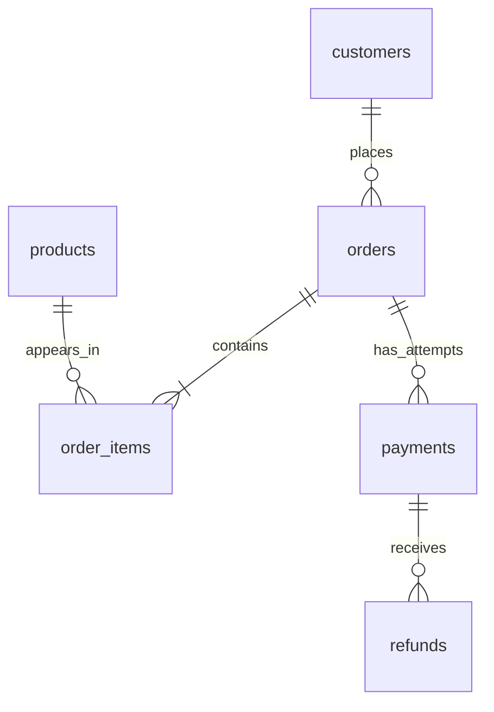

# Architecture

## Current state: Day 3

The installable Python package now provides a FastAPI application, health and metadata
routes, generated API documentation, environment settings, JSON logs, explicit-origin CORS,
and sanitized exception handling. Day 3 adds PostgreSQL infrastructure invoked explicitly
by migration, seed, and verification commands. API initialization remains database-free.
There is no LLM integration, chat endpoint, frontend, full application deployment, or CI.

## Database architecture

`db/models.py` defines six typed SQLAlchemy entities and bidirectional relationships.
Alembic migration `0001` creates their tables, named constraints, FK and analytics indexes,
and partial uniqueness for successful payments. `create_all` is not used.



The detailed column diagram and accounting contract are in [database.md](database.md).
`db/session.py` lazily creates pooled PostgreSQL/Psycopg engines. Connection/lock/statement
and pool-wait timeouts are bounded. Each operation uses a sessionmaker transaction with
explicit commit/rollback/close boundaries, following SQLAlchemy's
[session context-manager pattern](https://docs.sqlalchemy.org/en/20/orm/session_basics.html).
SQLAlchemy errors are translated to a fixed diagnostic without driver SQL/parameters.
Connection URLs are SecretStr settings and SQL parameter logging is hidden.

Data flow is: reference date + local RNG → in-memory fixture → one locked writer
transaction → PostgreSQL → read-only verifier/developer SQL. Seed refuses to mix different
fixtures or overwrite partial/edited data. Tables enforce row-local constraints and FKs;
cross-row totals/refund/status invariants are checked by seed/verification, not triggers.
Future writers must preserve them explicitly.

`DATABASE_URL` is the migration/seed writer. `READER_DATABASE_URL` is distinct, for a
SELECT-only role provisioned after migrations. The reader receives no DML/schema/TEMP
privileges and owns no tables; read-only session defaults add defense in depth. No agent
tool registry is implemented yet. Compose contains only the persistent development
PostgreSQL service; Docker's container runtime was not available during verification.

## FastAPI composition

`querypilot.main.create_app()` composes the application; `querypilot.main.app` is the
Uvicorn entry point. Metadata uses the installed distribution's version (`0.1.0`) so
health, info, and OpenAPI agree. Startup/shutdown lifespan hooks configure application
logging and record lifecycle events. Startup does not contact any external services.

`api/router.py` mounts unversioned `/health` and the info router under `/api/v1`.
`api/routes/health.py` reports process liveness only. `api/routes/info.py` reports app
metadata. `schemas/system.py` defines typed response/error contracts. FastAPI generates
`/docs`, `/redoc`, and `/openapi.json`. Browser documentation assets use the framework's
CDN defaults; serving documentation HTML was tested, browser rendering was not.

`core/config.py` loads Pydantic Settings with the `QUERYPILOT_` prefix. Environment
variables override the optional UTF-8 `.env` file. Defaults require no external secrets.
Settings are cached per process and injectable into `create_app()` for isolated tests.
Log levels and CORS origins are validated; invalid configuration fails startup.

`api/errors.py` registers handlers for HTTP exceptions, request validation failures,
and unexpected errors. Error envelopes carry a code, safe message, request ID, and
validation issue locations/types. Raw validation inputs, exception details, and stack
traces are excluded. The handler design follows FastAPI's
[exception-handler interface](https://fastapi.tiangolo.com/tutorial/handling-errors/).

`api/middleware.py` generates request IDs and JSON access records. It catches failures
before response headers are sent, logs only the exception class, and produces a sanitized
500 response. After headers have been sent, a response cannot be replaced; a fixed
diagnostic terminates a failed stream. No streaming endpoints are implemented on Day 2.
The logger uses fixed events and an allowlist of record fields. It logs route templates
rather than raw URLs, and excludes request bodies, headers, queries, settings, and
exception messages. Uvicorn's raw access logging is disabled during startup.

Outer Starlette CORS middleware decorates ordinary and sanitized error responses. No
origins are permitted by default; configured origins must be exact HTTP(S) origins.
Wildcard origins and credentials are disabled; only GET is advertised. Preflights use
the framework's standard protocol responses and may be handled before request logging.
CORS is not authentication.

## Planned request flow

```text
Streamlit (Day 9)
    → FastAPI routes
    → Business services / agent orchestration
    → Approved tools
        → Predefined analytics queries → restricted PostgreSQL reader
        → Document search → synthetic business documents
    → Evidence-backed response with tool execution traces
```

The model will choose among approved operations. Application code will validate arguments,
enforce limits, execute tools, and return results for response synthesis. Traces will
expose operations and evidence, not private model reasoning.

## Package responsibilities

| Directory | Intended responsibility |
| --- | --- |
| `src/querypilot/api/routes/` | HTTP routes and transport error mapping |
| `src/querypilot/agent/` | Bounded multi-step model/tool orchestration |
| `src/querypilot/tools/` | Approved analytics and document-search interfaces |
| `src/querypilot/db/` | Models, sessions, predefined parameterized queries |
| `src/querypilot/schemas/` | Pydantic request, response, tool-argument validation |
| `src/querypilot/services/` | Business workflows independent of HTTP |
| `src/querypilot/core/` | Environment configuration and shared infrastructure |
| `tests/` | Original import smoke test, API/error/logging/CORS tests, settings tests |
| `data/sample/` | Small, publicly shareable synthetic fixtures |
| `docs/` | Architecture and milestone progress |

Dependencies should flow from routes to services/orchestration and tools to data access.
Database code must not depend on routes; orchestration should be testable with a fake
provider. Imports must not perform external I/O. The src layout requires installation
for package imports rather than relying on application code at the repository root.

## Technology and security

Python 3.12 is the baseline. FastAPI, Pydantic, Pydantic Settings, and Uvicorn support the
current backend. SQLAlchemy, Psycopg, and Alembic support the explicit database workflow.
Pytest, Ruff, and HTTPX support development and tests. OpenAI tool calling, Streamlit,
full Docker deployment, and GitHub Actions arrive later.

There will be no arbitrary SQL interface. Tools will accept validated business parameters
for code-owned queries. Agent credentials will be read-only and separate from setup
credentials. Secrets will come from environment variables. All data will be synthetic.
Retrieved content is untrusted and must not grant permissions. Iterations, timeouts,
and results will be bounded. Enforcement and security tests arrive with each feature.
