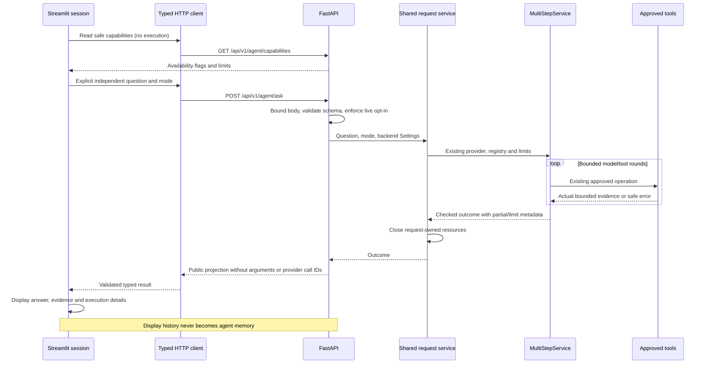
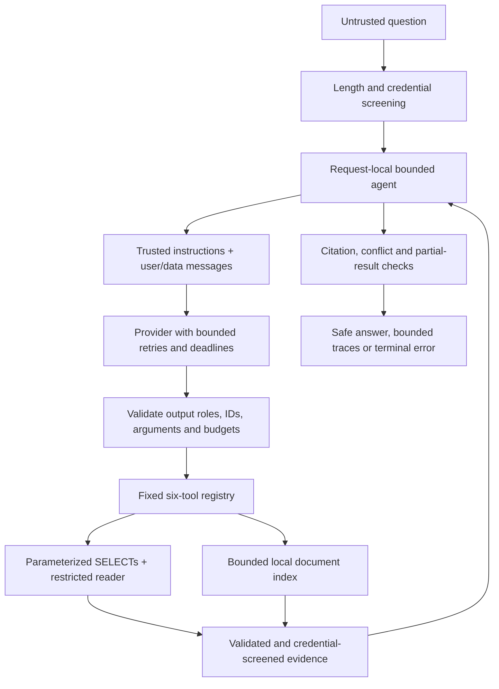
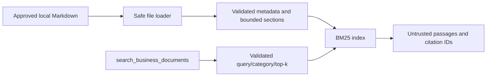
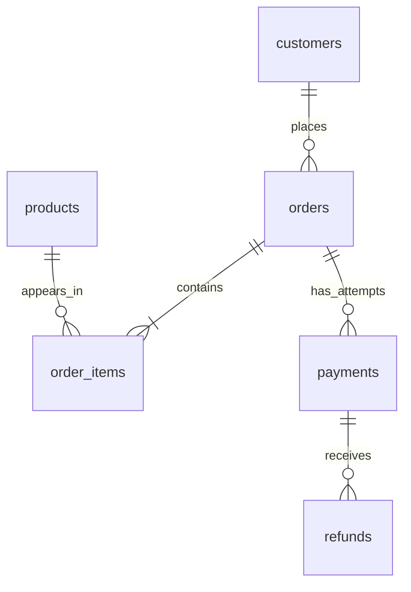

# Architecture

## Current state: Day 12

The installable Python package now provides a FastAPI application, health and metadata
routes, generated API documentation, environment settings, JSON logs, explicit-origin CORS,
and sanitized exception handling. Day 3 adds PostgreSQL infrastructure invoked explicitly
by migration, seed, and verification commands. API initialization remains database-free.
The direct OpenAI adapter and bounded multi-step service are implemented with mock/protocol
verification; actual OpenAI verification is pending. Day 9 adds Streamlit chat and an
agent HTTP endpoint for local development. Persistent agent memory, public deployment
remain outside the implemented scope. CI is configured but remote execution is unverified.

## Container architecture and CI

Compose isolates a named PostgreSQL volume from native data. PostgreSQL connection health
gates a one-shot administrative setup container; setup reuses Alembic/seed/verify and reader
audits. Its successful exit gates the backend, and backend `/ready` gates Streamlit.
Frontend HTTP uses `backend:8000`. Backend receives only restricted reader access; frontend
receives only its API origin. Apps run non-root with read-only root filesystems and dropped
capabilities. Only application ports are published, bound to loopback.

`/health` stays database-independent. `/ready` invokes read-only doctor checks in a sync
request worker, returning safe status codes for configuration/schema/seed/permission/corpus
failures. It performs no provisioning. Exact fixture comparison belongs to setup and
evaluation; it is not repeated on every readiness request.

CI uses locked dependencies, an ephemeral PostgreSQL 16 instance with generated credentials,
full tests/coverage, mandatory original PostgreSQL case IDs and the reviewed Day 11 gate.
A separate image job builds both images, configures container smoke/recovery/persistence/log
checks and shuts down without deleting volumes. No images are published. Configuration and
native results do not establish container or GitHub readiness. See [containers.md](containers.md).

## Day 11 evaluation boundaries

Day 11 adds `evaluation/dataset.py`, `runner.py`, `metrics.py`, `reports.py` and an eval CLI.
It wraps the existing shared lifecycle with a counted mock provider, never a second agent.
Ground truth is independent Python Decimal aggregation over seed rows plus curated policy
judgments. A read-only exact six-table fixture comparison gates SQL evaluation; standalone
BM25 probes separate retrieval scoring from final answers. Outcomes feed deterministic
per-case checks and denominator-aware category/aggregate JSON and Markdown reports.
Reports omit raw arguments/prompts/full records and pass through existing secret screening.
See [evaluation.md](evaluation.md) for formulas, execution boundaries and unmeasured semantics.

## Day 10 integration boundaries

The mock provider chooses approved tools deterministically; real integration tests still
execute PostgreSQL analytics and document retrieval. In-process TestClient tests verify
the API/service boundary separately from actual TCP tests. A session-owned loopback server
supports typed-client and Streamlit AppTest requests through FastAPI, orchestration,
registry, real restricted database access and evidence serialization. Owned resources are
closed at teardown. Mocked HTTP tests remain useful component checks, not full-system proof.

Native local preparation creates owned, separate synthetic dev/test databases using the
existing migration/seed infrastructure. Integration mutations require a dedicated target
and explicit acknowledgement, with cleanup restricted to owned schemas. The doctor checks
readiness without writes or model calls. Neither health nor capabilities proves SQL
readiness. Missing reader configuration caused the observed normal-startup SQL failure;
earlier explicitly configured test backends did not establish normal-startup readiness.
See [testing.md](testing.md) for commands, verification labels and measured results.

## Frontend and agent HTTP flow



`services/agent.py` owns one request's provider/registry lifecycle and calls the existing
MultiStepService. CLI and HTTP reuse it; orchestration is not duplicated in the frontend.
The CLI keeps its factory injection seams for compatibility with prior security tests.
API startup/capabilities do not construct a provider or connect to PostgreSQL.

`api/routes/agent.py` exposes ask/capabilities with Pydantic contracts in schemas/agent.py.
The POST accepts only question and mock/live mode. A streaming body middleware caps
the request at 65536 bytes before JSON parsing; question length and existing limits
remain in force. Live HTTP calls require backend agent_live_enabled as well as valid
key/model configuration. This gate does not change the CLI's explicit --live behavior.

Public responses retain actual typed evidence and errors, iteration/order/duration,
partial/limitations/pending metadata, an HTTP request ID and the agent trace ID. Raw
arguments, provider call IDs, prompts, reasoning and internal conversation items are
omitted. Citation/trace coherence and UUID identifiers validate at the public boundary.
Agent failures remain structured outcomes; HTTP validation/permission/unexpected errors
use the existing safe envelope.

`frontend/api_client.py` performs bounded HTTP requests with explicit connect/read
timeouts, no redirects, inherited proxy credentials or automatic retries. It checks
schemas and response mode before returning data. FrontendSettings reads only the API
origin from environment and does not load backend .env settings or API keys.

`frontend/app.py` keeps up to 20 displayed exchanges in Streamlit session state. Example
buttons fill the composer, mode changes only fetch safe metadata, and an explicit
submission queues one request. Pending state disables controls; reruns display stored
responses without resending. Clearing affects UI history only. There is no backend
conversation-memory API or persistent store.

`frontend/components.py` renders narrative/passages as plain text, SQL rows as read-only
tables and exact source IDs as code. It never converts retrieved HTML/images into active
Markdown content. Errors use fixed diagnostics; the UI does not display raw exception
or HTTP error messages. Mock/live labels and partial/conflict/grounding notices remain
visible. .streamlit/config.toml supplies only a restrained built-in theme and loopback defaults.

Both servers are local development processes, without authentication, authorization or
rate limiting. Public deployment needs those controls and deployment hardening. CORS
allows explicit GET/POST origins but is not authentication; Streamlit's server-side HTTP
client does not need browser CORS. See [frontend.md](frontend.md) for startup and limitations.

## Security and reliability boundaries



Trusted instructions come from code. Questions, SQL text fields and document passages
remain user/function-output data; they cannot supply system/developer authority. Provider
message roles are checked before replay. Model names cannot select dynamic code, URLs,
filesystem paths or SQL. Existing registry schemas, SQL privileges and read-only
transactions remain the actual capability boundary. No tool exposes settings or secrets.

`core/security.py` screens configured credentials and recognizable secret patterns.
Questions and decoded provider arguments are checked before dispatch; credential-bearing
tool data is withheld in both direct registry and agent paths. `agent/provider.py` exposes
only a fixed diagnostic catalog, including unexpected errors. JSON logging applies a
credential/sensitive-field redaction backup. Settings remain SecretStr-backed; full
configuration, headers and environment mappings are never serialized to model context.

`agent/execution.py` retains each worker Task, shields it from outer cancellation and
drains it before cancellation propagates or resources close. This avoids abandoned tool
tasks and cleanup racing an in-flight registry operation. No later batch member starts
after a deadline. Native SQL and file-loader bounds remain important because Python
cannot safely terminate a thread. Cleanup can exceed the execution budget; see
[security.md](security.md) for the supported boundary and hung-extension limitation.

Message counts are checked before API calls and reserve every result slot before tool
I/O. Accepted-but-unresolved batch calls are counted in pending_tool_calls. Partial and
limitations identify selected/truncated records, empty results, tool failures and stopped
execution. Conflicting scoped row values or versions of one passage citation stop
synthesis. Citation-to-document consistency and per-output uniqueness validate provenance;
they do not establish semantic correctness of every statement.

Agent tool and terminal logs share trace IDs. Safe fields include mode, status, approved
tool name, iteration/tool counts, elapsed time, error category, limit reason and pending
count. Raw prompts, model reasoning, record bodies, arguments and provider diagnostics
are excluded. No new telemetry platform or persistent request state was introduced.

## Multi-step model/tool service

```mermaid
sequenceDiagram
    participant U as CLI
    participant A as MultiStepService
    participant S as Request-local AgentState
    participant M as Responses provider
    participant R as Six-tool registry
    U->>A: Question and validated limits
    A->>S: New request ID, question, empty evidence
    loop At most configured model iterations
        A->>A: Check deadline and serialized context budget
        A->>M: Instructions, schemas and full bounded history
        M-->>A: Output items and optional function calls
        alt Tool calls
            A->>A: Validate batch count, unique IDs and context
            loop Each call, sequentially
                A->>A: Suppress canonical duplicates
                A->>R: Approved name and validated arguments
                R-->>A: Typed evidence or sanitized error
                A->>S: Bounded evidence, citations, trace and original call ID
            end
        else Answer without calls
            A->>A: Check evidence references, source citations and numbers
            A-->>U: Checked answer or explicit uncertainty
        end
    end
    Note over A,U: Limits/errors preserve earlier evidence; no fabricated partial answer
```

`agent/multistep.py` reuses the Day 6 execution/provider boundary instead of recreating
registry dispatch. It is provider-independent: live responses decide tool selection and
continuation; only the explicit mock provider has deterministic fixture plans. Each model
request is one iteration, including the final answer. Several calls can share an iteration.
All output items, including encrypted reasoning, and original call_id-correlated results
are replayed without trimming away protocol items. Context exhaustion stops execution.

`agent/state.py` holds one run's UUID, question, monotonic start, iteration, message history,
call IDs, canonical fingerprints, bounded tool results/citations, errors and status. State
is constructed inside run(), never stored on the service or persisted. Public outcomes
include iterations/elapsed_ms and each trace's iteration; internal messages and fingerprints
are never emitted. The CLI owns a registry/provider for one request and closes them.

Errors from invalid JSON/arguments, unknown names, empty results and ordinary tool failures
can be returned to the model for recovery. Canonical duplicate calls, including omitted
versus explicit defaults, return repeated_call without executing again; they still count
toward the call budget. Reused protocol IDs and malformed/oversized batches abort before
any execution in that batch. Tool deadlines stop further work to avoid overlapping a
still-running synchronous worker. Provider failures, context/evidence exhaustion, overall
deadlines and iteration/call limits stop with structured errors and prior evidence.

The defaults are 5 model requests, 10 total calls, 5 calls per round, 90 seconds, 128,000
serialized context bytes and 48,000 accumulated evidence bytes. Whole records are bounded
before replay/trace storage. Context counts instructions, schemas and complete history;
it is a UTF-8 byte budget, not a token count or provider context-window guarantee. Worker
threads cannot be forcibly cancelled, so process shutdown can exceed the await deadline.
See [agent.md](agent.md) for exact hard limits and [llm.md](llm.md) for adapter details.

All six tools retain their existing validation, fixed SQL, restricted reader audit,
read-only transactions, server deadlines and safe retrieval. Grounding checks reject
unsupported IDs and some numeric claims; they do not establish semantic entailment or
prevent every prompt-injection attack. No model-driven SQL or command executor exists.

## Retained Day 6 single-round service


`agent/provider.py` wraps AsyncOpenAI, using explicit key/model settings, bounded transient
retries, a logical request deadline and safe typed provider errors. No client is constructed
at package import. `agent/tool_schemas.py` derives strict, nullable-optional schemas from
registry definitions and normalizes null defaults back to existing Pydantic behavior.

`agent/orchestrator.py` performs at most two logical model requests. All first-response
output items, including encrypted reasoning, are replayed with call_id-matched function
outputs and store=false. It does not expose those provider objects in public traces.
The second request disables tools; any additional call is rejected without execution.
No-call/no-evidence responses return explicit uncertainty and skip synthesis.

`agent/evidence.py` trims complete records under row and UTF-8 packet budgets; it never
cuts JSON mid-record. Document citations come only from forwarded passages. Final answers
need valid evidence IDs, exact associated source citations and supported numeric literals.
These are mechanical checks, not semantic entailment or a grounding guarantee.

`schemas/llm.py` exposes safe outcomes/evidence traces. The current ask CLI uses the new
multi-step service; SingleRoundService remains independently usable and regression-tested.
Mock mode uses deterministic provider fixtures with the real registry; live errors never
switch modes. Synchronous tools execute off the event
loop, with an await deadline and skip-on-timeout behavior. Worker threads are not forcibly
terminated; database-side timeouts still matter. See [llm.md](llm.md) for exact limits,
protocol references, grounding limitations and current live-verification status.

## Document ingestion and retrieval



`services/document_search.py` loads immediate Markdown files from the approved directory,
validates IDs/metadata, chunks sections and builds an in-memory BM25 index. It bounds
files/collections, uses descriptor-relative no-follow opening and regular-file checks,
and accepts no path from tool callers. Ancestor directories are trusted operator
infrastructure; safe loading requires POSIX support and fails closed otherwise.
Missing/invalid collections give sanitized errors; empty collections give empty results.

`schemas/documents.py` adds typed search arguments and passage results. The shared
envelope now supports six operations. Registry SQL and document resources initialize
independently on first use. Search does not create a database engine; SQL calls still
require restricted reader configuration and preserve every role/transaction check.

Ranking uses normalized lexical tokens, fixed BM25 parameters, category filtering and
citation tie-breaking. No model, embeddings or external service is used. Indexes are
registry-local snapshots; recreate them after edits. Citations identify document/section/
part in that snapshot, not immutable versions across edits. Text is never executed and
query/passage content is excluded from execution logs. See [document_search.md](document_search.md).

`services/evaluate_search.py` runs registry searches over 20 authored questions with
expected relevant document IDs and measures Hit Rate@5 and first-passage MRR@5. The
results in progress.md describe a small regression set, not general semantic accuracy
or future-model prompt-injection resistance.

## Analytics tools and execution flow


`schemas/analytics.py` defines five analytics contracts and the shared result envelope;
`schemas/documents.py` adds the sixth operation. `tools/registry.py` exposes a fixed allowlist,
schemas/descriptions, validation and dispatch, without an LLM-specific format or dynamic
registration. `tools/__main__.py` is a developer CLI; no HTTP endpoint was added.

`db/analytics.py` contains fixed SQLAlchemy SELECT builders. The allowlisted grouping
selects code-owned expressions; supplied dates/IDs/limits become bind parameters. Queries
select only approved fields, with explicit SQL/fetch bounds. Revenue uses completed orders;
payments and refunds use their own dates/accounting semantics, avoiding multiplied sums.
See [tools.md](tools.md) for exact rules, per-category count semantics and truncation.

Every SQL tool execution uses the separately configured reader engine, a read-only transaction,
and a local statement timeout. Before selecting analytics data, a role audit rejects
elevated flags/memberships, role switching, table ownership, DML privileges, database
CREATE/TEMP and schema CREATE, and requires SELECT on all six tables. No writer URL
fallback exists. The audit concerns the active analytics schema, not all cluster objects.
Database privileges remain the write barrier when session defaults are disabled.

Registry results validate before serialization; Decimal money is emitted as strings.
Unknown/malformed calls fail before database access. PostgreSQL cancellation maps to a
stable timeout code after rollback; raw driver/SQL/credential details are excluded.
Application logs allowlist only known tool name, status and elapsed time, never arguments
or customer personal fields. Query timeouts are per statement; a whole-agent deadline is
outside Day 4. The existing pool/connection bounds remain in effect.

## Database architecture

`db/models.py` defines six typed SQLAlchemy entities and bidirectional relationships.
Alembic migration `0001` creates their tables, named constraints, FK and analytics indexes,
and partial uniqueness for successful payments. `create_all` is not used.



The detailed column diagram and accounting contract are in [database.md](database.md).
`db/session.py` lazily creates pooled PostgreSQL/Psycopg engines. Connection/lock/statement
and pool-wait timeouts are bounded. Each operation uses a sessionmaker transaction with
explicit commit/rollback/close boundaries, following SQLAlchemy's
[session context-manager pattern](https://docs.sqlalchemy.org/en/20/orm/session_basics.html).
SQLAlchemy errors are translated to a fixed diagnostic without driver SQL/parameters.
Connection URLs are SecretStr settings and SQL parameter logging is hidden.

Data flow is: reference date + local RNG → in-memory fixture → one locked writer
transaction → PostgreSQL → read-only verifier/developer SQL. Seed refuses to mix different
fixtures or overwrite partial/edited data. Tables enforce row-local constraints and FKs;
cross-row totals/refund/status invariants are checked by seed/verification, not triggers.
Future writers must preserve them explicitly.

`DATABASE_URL` is the migration/seed writer. `READER_DATABASE_URL` is distinct, for a
SELECT-only role provisioned after migrations. The reader receives no DML/schema/TEMP
privileges and owns no tables; read-only session defaults add defense in depth. The Day 4
registry uses this reader configuration. Compose contains only the persistent development
PostgreSQL service; Docker's container runtime was not available during verification.

## FastAPI composition

`querypilot.main.create_app()` composes the application; `querypilot.main.app` is the
Uvicorn entry point. Metadata uses the installed distribution's version (`0.1.0`) so
health, info, and OpenAPI agree. Startup/shutdown lifespan hooks configure application
logging and record lifecycle events. Startup does not contact any external services.

`api/router.py` mounts unversioned `/health`, info under `/api/v1`, and Day 9 ask/capabilities
under `/api/v1/agent`.
`api/routes/health.py` reports process liveness only. `api/routes/info.py` reports app
metadata. `schemas/system.py` defines typed response/error contracts. FastAPI generates
`/docs`, `/redoc`, and `/openapi.json`. Browser documentation assets use the framework's
CDN defaults; serving documentation HTML was tested, browser rendering was not.

`core/config.py` loads Pydantic Settings with the `QUERYPILOT_` prefix. Environment
variables override the optional UTF-8 `.env` file. Defaults require no external secrets.
Settings are cached per process and injectable into `create_app()` for isolated tests.
Log levels and CORS origins are validated; invalid configuration fails startup.

`api/errors.py` registers handlers for HTTP exceptions, request validation failures,
and unexpected errors. Error envelopes carry a code, safe message, request ID, and
validation issue locations/types. Raw validation inputs, exception details, and stack
traces are excluded. The handler design follows FastAPI's
[exception-handler interface](https://fastapi.tiangolo.com/tutorial/handling-errors/).

`api/middleware.py` generates request IDs and JSON access records. It catches failures
before response headers are sent, logs only the exception class, and produces a sanitized
500 response. After headers have been sent, a response cannot be replaced; a fixed
diagnostic terminates a failed stream. No streaming endpoints are implemented on Day 2.
The logger uses fixed events and an allowlist of record fields. It logs route templates
rather than raw URLs, and excludes request bodies, headers, queries, settings, and
exception messages. Uvicorn's raw access logging is disabled during startup.

Outer Starlette CORS middleware decorates ordinary and sanitized error responses. No
origins are permitted by default; configured origins must be exact HTTP(S) origins.
Wildcard origins and credentials are disabled; GET and POST are advertised. Preflights use
the framework's standard protocol responses and may be handled before request logging.
CORS is not authentication.

## Planned request flow

```text
Streamlit (Day 9)
    → FastAPI routes
    → Business services / agent orchestration
    → Approved tools
        → Predefined analytics queries → restricted PostgreSQL reader
        → Document search → synthetic business documents
    → Evidence-backed response with tool execution traces
```

The model will choose among approved operations. Application code will validate arguments,
enforce limits, execute tools, and return results for response synthesis. Traces will
expose operations and evidence, not private model reasoning.

## Package responsibilities

| Directory | Intended responsibility |
| --- | --- |
| `src/querypilot/api/routes/` | HTTP routes and transport error mapping |
| `src/querypilot/agent/` | Bounded multi-step model/tool orchestration |
| `src/querypilot/tools/` | Approved analytics and document-search interfaces |
| `src/querypilot/db/` | Models, sessions, predefined parameterized queries |
| `src/querypilot/schemas/` | Pydantic request, response, tool-argument validation |
| `src/querypilot/services/` | Business workflows independent of HTTP |
| `src/querypilot/core/` | Environment configuration and shared infrastructure |
| `src/querypilot/frontend/` | Streamlit presentation, display-only history and typed HTTP client |
| `tests/` | Original import smoke test, API/error/logging/CORS tests, settings tests |
| `data/sample/` | Small, publicly shareable synthetic fixtures |
| `docs/` | Architecture and milestone progress |

Dependencies should flow from routes to services/orchestration and tools to data access.
Database code must not depend on routes; orchestration should be testable with a fake
provider. Imports must not perform external I/O. The src layout requires installation
for package imports rather than relying on application code at the repository root.

## Technology and security

Python 3.12 is the baseline. FastAPI, Pydantic, Pydantic Settings, and Uvicorn support the
current backend. SQLAlchemy, Psycopg, and Alembic support the explicit database workflow.
Pytest and Ruff support development/tests. HTTPX supports frontend HTTP transport and
test clients; Streamlit supplies the current local UI. The official OpenAI SDK supports
the current mock/protocol-verified adapter. Full Docker deployment and GitHub Actions
arrive later.

There will be no arbitrary SQL interface. Tools will accept validated business parameters
for code-owned queries. Agent credentials will be read-only and separate from setup
credentials. Secrets will come from environment variables. All data will be synthetic.
Retrieved content is untrusted and must not grant permissions. Iterations, timeouts,
and results will be bounded. Enforcement and security tests arrive with each feature.
